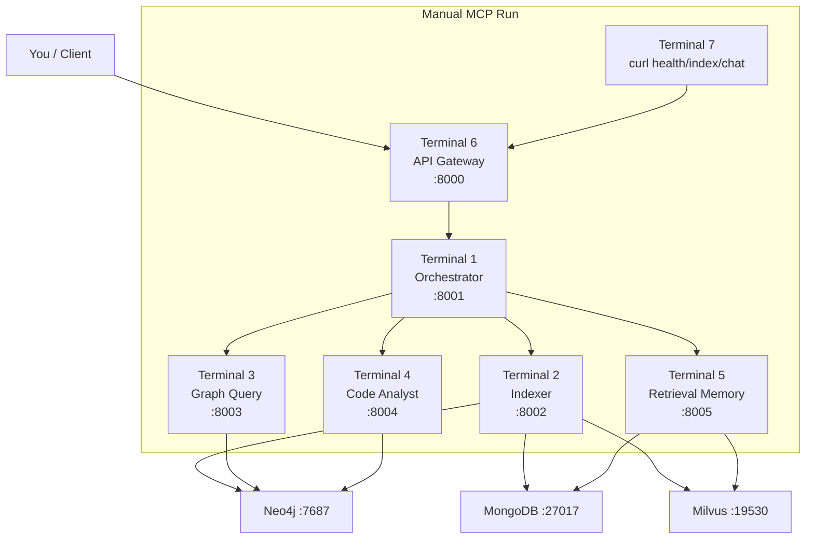

# Opsly - Multi-Agent MCP System for FastAPI Codebase Analysis

Production-ready multi-agent system built on the **Model Context Protocol (MCP)** that answers questions about the [FastAPI](https://github.com/tiangolo/fastapi) codebase. The system features five specialized MCP servers, a knowledge graph (Neo4j), vector search (Milvus), conversation memory (MongoDB), and a FastAPI gateway with streaming support.

---

## Architecture Overview

```
User Query
     │
     ▼
┌─────────────────────┐
│   API Gateway :8000  │  FastAPI + WebSocket
└─────────┬───────────┘
          │
          ▼
┌─────────────────────┐
│  Orchestrator :8001  │  Query analysis, routing, synthesis
└─────────┬───────────┘
          │
    ┌─────┼─────────┬──────────────┐
    │     │         │              │
    ▼     ▼         ▼              ▼
┌───────┐ ┌───────┐ ┌───────────┐ ┌──────────────┐
│Indexer│ │Graph  │ │Code       │ │Retrieval-    │
│:8002  │ │Query  │ │Analyst    │ │Memory :8005  │
│       │ │:8003  │ │:8004      │ │              │
└───┬───┘ └───┬───┘ └─────┬─────┘ └──────┬───────┘
    │         │           │              │
    ▼         ▼           │              ▼
┌─────────────────┐       │     ┌──────────────────┐
│  Neo4j  :7474   │◄──────┘     │  MongoDB  :27017 │
│  (Knowledge     │              │  (Memory/Cache)  │
│   Graph)        │              └──────────────────┘
└─────────────────┘                      │
         │                               ▼
         └──────────────────►  ┌──────────────────┐
                               │  Milvus  :19530  │
                               │  (Vector Search) │
                               └──────────────────┘
```

### MCP Agents

| Agent | Port | Responsibilities |
|-------|------|-----------------|
| **Orchestrator** | 8001 | Query classification, agent routing, response synthesis |
| **Indexer** | 8002 | Repository cloning, AST parsing, entity extraction, embedding generation |
| **Graph Query** | 8003 | Cypher queries, dependency tracing, relationship traversal |
| **Code Analyst** | 8004 | Function/class analysis, pattern detection, LLM-powered explanations |
| **Retrieval-Memory** | 8005 | Conversation memory, semantic search, agent response caching |

### Infrastructure

| Service | Port(s) | Purpose |
|---------|---------|---------|
| **Neo4j** | 7474, 7687 | Code knowledge graph (entities, relationships) |
| **MongoDB** | 27017 | Sessions, messages, routing decisions, agent cache |
| **Milvus** | 19530, 9091 | Vector similarity search for code chunks |

---

## Quick Start

### Prerequisites

- Docker and Docker Compose
- Python 3.11+
- At least one LLM API key (OpenAI, Anthropic, or Gemini)

### 1) Clone and Configure

```bash
git clone https://github.com/Tanzir11/opsly-assignment.git && cd Opsly

# Copy environment file and add your API keys
cp .env.example .env
# Edit .env and add at least one LLM API key
```

### 2) Choose a Run Style

You can run Opsly in two ways:

- **Style A (recommended): Docker Compose**
- **Style B: Manual MCP terminals (7 terminals)**

---

## Style A - Run with Docker Compose

### Start all services

```bash
docker compose up --build
```

This starts all services (infrastructure + 5 MCP agents + gateway) with health checks and dependency ordering.

### Health checks

```bash
curl -s http://localhost:8000/health
curl -s http://localhost:8000/api/agents/health
```

### Create index

```bash
curl -s -X POST http://localhost:8000/api/index \
  -H "Content-Type: application/json" \
  -d '{"incremental": false}'
```

If you want to index a different repository, update `FASTAPI_REPO_URL` in `.env` first.

### Check indexing status every couple of seconds, There is a support for opensource model but that was ocomputationally expensive so i was unable to test it instead used a deployed model for testings.

```bash
curl -s http://localhost:8000/api/index/status/<JOB_ID>
```

### Ask a question keep updating session-id for clear history

```bash
curl -s -X POST http://localhost:8000/api/chat \
  -H "Content-Type: application/json" \
  -d '{"message":"What is the FastAPI class?","session_id":"demo1"}'
```

### API docs URL ( Currently during a push docs are not disabled)

After services are up, open:

- `http://localhost:8000/docs` (Swagger UI)
- `http://localhost:8000/redoc` (ReDoc)

---

## Style B - Manual MCP Environment (7 Terminals)

This mode is useful for debugging each MCP server independently.

### Setup (one-time)

```bash
python -m venv .venv
source .venv/bin/activate
pip install -e ".[dev]"
```

### Start infrastructure (required for local MCP servers)

```bash
docker compose up neo4j mongodb etcd minio milvus -d
```

### Start terminals 1-6 exactly as below

```bash
# Terminal 1
uvicorn src.modules.orchestrator.server:app --host 0.0.0.0 --port 8001

# Terminal 2
uvicorn src.modules.indexer.server:app --host 0.0.0.0 --port 8002

# Terminal 3
uvicorn src.modules.graph_query.server:app --host 0.0.0.0 --port 8003

# Terminal 4
uvicorn src.modules.code_analyst.server:app --host 0.0.0.0 --port 8004

# Terminal 5
uvicorn src.modules.retrieval_memory.server:app --host 0.0.0.0 --port 8005

# Terminal 6
uvicorn src.app:app --host 0.0.0.0 --port 8000 --reload
```

### Terminal 7: verify health + index + ask question

```bash
curl -s http://localhost:8000/health
curl -s http://localhost:8000/api/agents/health

curl -s -X POST http://localhost:8000/api/index \
  -H "Content-Type: application/json" \
  -d '{"incremental": false}'

curl -s http://localhost:8000/api/index/status/<JOB_ID>

curl -s -X POST http://localhost:8000/api/chat \
  -H "Content-Type: application/json" \
  -d '{"message":"What is the FastAPI class?","session_id":"demo1"}'
```

### API docs URL (manual mode)

Run **Terminal 1 to Terminal 6 first**, then open:

- `http://localhost:8000/docs`

---

## Manual Mode Diagram (Terminals + Ports)



---

## API Documentation

### Core Endpoints

| Method | Path | Description |
|--------|------|-------------|
| `POST` | `/api/chat` | Send message, receive response (supports streaming) |
| `POST` | `/api/index` | Trigger repository indexing |
| `GET` | `/api/index/status/{job_id}` | Check indexing job status |
| `GET` | `/api/agents/health` | Health check for all agents |
| `GET` | `/api/graph/statistics` | Knowledge graph statistics |
| `WebSocket` | `/ws/chat` | Real-time streaming chat |

### Chat Request

```json
{
  "session_id": "optional-session-id",
  "message": "What is the FastAPI class?",
  "stream": false,
  "metadata": {}
}
```

### Chat Response

```json
{
  "session_id": "abc123",
  "message_id": "msg_xyz",
  "response": "FastAPI is the main application class...",
  "agents_used": ["graph_query", "code_analyst"],
  "sources": [
    {"file_path": "fastapi/applications.py", "entity_name": "FastAPI"}
  ],
  "correlation_id": "corr_123"
}
```

### Run Tests

```bash
pytest tests/ -v --cov=src --cov-report=term-missing
```

---

## Knowledge Graph Schema

### Node Labels

| Label | Key Properties |
|-------|---------------|
| `File` | repo, path, sha, language, last_indexed_at |
| `Module` | entity_id, name, file_path |
| `Class` | entity_id, name, signature, file_path, start_line, end_line, doc |
| `Function` | entity_id, name, signature, file_path, start_line, end_line, doc |
| `Method` | entity_id, name, signature, file_path, start_line, end_line, doc |
| `Parameter` | entity_id, name, default, annotation |
| `Decorator` | entity_id, name |
| `Import` | entity_id, module, alias |
| `Chunk` | chunk_id, entity_id, file_path, content, token_count |

### Relationship Types

`CONTAINS` · `IMPORTS` · `INHERITS_FROM` · `CALLS` · `DECORATED_BY` · `HAS_PARAMETER` · `DOCUMENTED_BY` · `DEPENDS_ON` · `HAS_CHUNK`

---

## Configuration

All configuration uses **Pydantic Settings** with environment variable support.

### Environment Files

| File | Purpose |
|------|---------|
| `.env` | Base config + APP_ENV flag |
| `.env.develop` | Development overrides (loaded when `APP_ENV=development`) |
| `.env.staging` | Staging overrides (loaded when `APP_ENV=staging`) |

### Key Configuration Options

| Variable | Default | Description |
|----------|---------|-------------|
| `APP_ENV` | development | Environment flag |
| `NEO4J_URI` | bolt://localhost:7687 | Neo4j connection |
| `MONGODB_URI` | mongodb://localhost:27017 | MongoDB connection |
| `MILVUS_HOST` | localhost | Milvus host |
| `EMBEDDING_DEFAULT_PROVIDER` | local | Embedding provider (local/openai) |
| `EMBEDDING_MODEL_CODE` | all-MiniLM-L6-v2 | Local embedding model |
| `AGENT_TIMEOUT_SECONDS` | 30.0 | Inter-agent call timeout |
| `AGENT_MAX_RETRIES` | 2 | Retry count on agent failure |

---

## Design Decisions and Trade-offs

### Why Five MCP Servers?

The assignment specifies four agents. We added a fifth (**Retrieval-Memory**) to cleanly separate:
- Conversation memory persistence and retrieval
- Vector semantic search over code chunks
- Agent response caching

This keeps the orchestrator simpler and each agent more focused.

### Local-First Embeddings

We use `sentence-transformers` (all-MiniLM-L6-v2) by default to avoid API costs. Hosted fallback (OpenAI embeddings) activates only if local models fail or API keys are configured. (testing was done on hosted model because this approach was computationally expensive also could be improved about 7.71% in ranked retrieval results by performing semantic chunking)

### LLM Task-Based Routing

Different tasks route to different models:
- **Query analysis**: `gemini/gemini-2.5-flash-lite` (fallbacks: `anthropic/claude-haiku-4-5-20251001`, `openai/gpt-5.2`) # Does not require alot of intelligence and also the inference speed of 2.5flash lite on [artificial analysis](https://artificialanalysis.ai/models/gemini-2-5-flash-lite-preview-09-2025-reasoning) is 400+ super fast, very inexpensive and this task does not require alot of intelligence
- **Code explanation**: `openai/gpt-5.2-codex` (fallbacks: `anthropic/claude-sonnet-4-5-20250929`, `gemini/gemini-3-flash-preview`) ### This model is good for code so used it.
- **Response synthesis**: `openai/gpt-5.2` (fallbacks: `anthropic/claude-sonnet-4-5-20250929`, `gemini/gemini-3-flash-preview`)

Each route has a fallback chain (e.g., OpenAI -> Anthropic).

### Neo4j for Code Graph, MongoDB for Memory

- **Neo4j**: Excellent for relationship traversal (dependency chains, inheritance trees)
- **MongoDB**: Better for document storage (messages, cache, jobs) with TTL indexes
- **Milvus**: Purpose-built for high-performance vector similarity search

### Incremental Indexing

The indexer supports both full and incremental modes. Incremental indexing uses git diff to identify changed files, avoiding re-processing the entire repository.

---

## Sample Queries

### Simple (single agent)
- "What is the FastAPI class?"
- "Show me the docstring for the Depends function"

### Medium (2-3 agents)
- "How does FastAPI handle request validation?"
- "What classes inherit from APIRouter?"
- "Find all decorators used in the routing module"

### Complex (multiple agents + synthesis)
- "Explain the complete lifecycle of a FastAPI request"
- "How does dependency injection work and show me examples from the codebase"
- "Compare how Path and Query parameters are implemented"
- "What design patterns are used in FastAPI's core and why?"

---

## Project Structure

```
src/
  app.py                              # API gateway entry point
  configs.py                          # Global + per-service settings
  core/
    logging.py                        # Structured logging + correlation IDs
    exceptions.py                     # Custom exception hierarchy
    models.py                         # Shared Pydantic models
    llm_router.py                     # Task-based LLM provider router
    embedding_router.py               # Task-based embedding router
    mcp_client.py                     # Async MCP client wrapper
  db/
    neo4j.py                          # Neo4j async driver and repositories
    mongodb.py                        # MongoDB async driver and repositories
    milvus.py                         # Milvus connection and helpers
    schema.py                         # Collection/index bootstrap
  modules/
    orchestrator/
      server.py                       # MCP server (:8001)
      tools.py                        # analyze_query, route_to_agents, synthesize_response
      planner.py                      # Query intent classification + routing
      synthesizer.py                  # Multi-agent response merger
    indexer/
      server.py                       # MCP server (:8002)
      tools.py                        # index_repository, index_file, parse_python_ast
      ast_parser.py                   # Python AST extraction
      repo_loader.py                  # Git clone/pull + file discovery
      entity_extractor.py             # AST -> graph entities + chunks
    graph_query/
      server.py                       # MCP server (:8003)
      tools.py                        # find_entity, get_dependencies, trace_imports
      graph_repository.py             # Parameterized Cypher query builders
    code_analyst/
      server.py                       # MCP server (:8004)
      tools.py                        # analyze_function, find_patterns, explain_implementation
      analyzers.py                    # AST analysis + pattern detection
    retrieval_memory/
      server.py                       # MCP server (:8005)
      tools.py                        # store_conversation_turn, semantic_search_chunks
      retrieval.py                    # Hybrid retrieval (vector + memory)
  api/
    routes_chat.py                    # POST /api/chat (+ SSE streaming)
    routes_index.py                   # POST /api/index, GET /api/index/status
    routes_health.py                  # GET /api/agents/health
    routes_graph.py                   # GET /api/graph/statistics
    ws_chat.py                        # WebSocket /ws/chat
tests/
docker/
  Dockerfile.gateway
  Dockerfile.agent
docker-compose.yml
pyproject.toml
README.md
```

---

## Known Limitations

- **Embedding dimension lock-in**: Switching embedding models requires re-indexing (different dimensions).
- **Single-repo focus**: Currently optimized for indexing one repository at a time.
- **No authentication**: The API gateway has no auth layer (Can change this is required ideally i prefer google oauth 2, but can work with jwt encryption with base64).
- **LLM dependency**: Complex queries (deep analysis, explanations) require a working LLM API key.
- **Memory growth**: MongoDB conversation memory grows without limit will have to add restriction later on.

## Future Improvements Ideas.

- Add OpenTelemetry distributed tracing
- Implement circuit breaker pattern for agent failures
- Add user authentication and rate limiting
- Support multiple repositories simultaneously
- Add incremental embedding updates (avoid full re-embed on file changes)
- Implement agent result caching with smarter invalidation
- Add Intrensic or Extrensic caching in specific gemini cases.